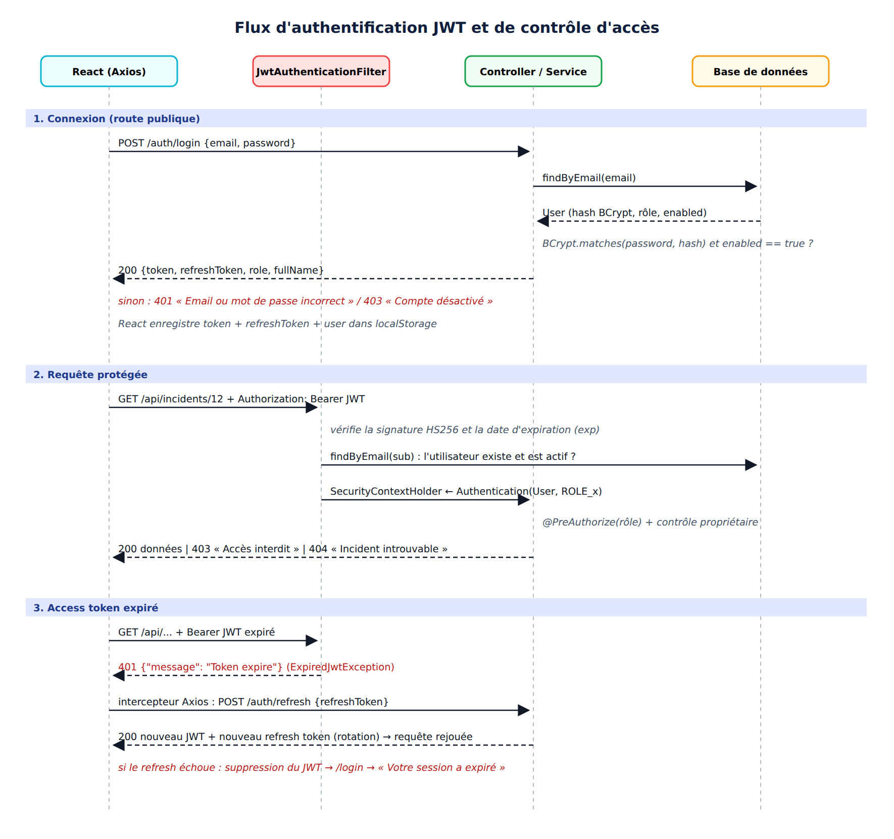

<p align="center">
  
</p>

<h1 align="center">🛡️ Guardian Incidents</h1>

<p align="center">
  <b>Plateforme de gestion des incidents informatiques et de cybersécurité</b><br>
  Authentification et autorisation avec Spring Boot, Spring Security, JWT et React
</p>

<p align="center">
  
  
  
  
  
  
  
</p>

Projet du module **Sécurité des systèmes distribués** (SDIA, 2e année), à l'**ENSET Mohammedia** (Université Hassan II de Casablanca).

- Réalisé par : **Hicham Ouaouche**
- Encadré par : **Pr. Abdelmajid BOUSSELHAM**

L'application permet aux employés d'une entreprise de déclarer des incidents (malware, phishing, panne réseau, fuite de données…). Les techniciens les traitent et l'administrateur supervise le tout.

## Aperçu

| Tableau de bord ADMIN | Traitement d'un incident (TECHNICIAN) |
|:---:|:---:|
|  |  |
| **Tableau de bord EMPLOYEE** | **Session expirée (JWT expiré)** |
|  |  |

## Architecture

<p align="center">
  
</p>

<details>
<summary><b>Diagramme des entités</b></summary>
<p align="center"></p>
</details>

<details>
<summary><b>Flux d'authentification JWT</b></summary>
<p align="center"></p>
</details>

---

## 1. Technologies

| Couche | Technologies |
|--------|--------------|
| Backend | Java 21, Spring Boot 3.2.5, Spring Security 6, Spring Data JPA (Hibernate), Bean Validation, JJWT 0.12.6, Lombok |
| Base de données | H2 en mémoire (par défaut), MySQL (profil `mysql`) |
| Frontend | React 18, Vite 6, React Router 6, Axios |
| Tests | JUnit 5 + MockMvc, Postman, curl |

## 2. Arborescence

```
Guardian-incidents/
├── README.md
├── backend/                                  # Projet Spring Boot (Maven)
│   ├── pom.xml
│   └── src/
│       ├── main/java/com/sdia/incidents/
│       │   ├── IncidentsApplication.java
│       │   ├── config/          # SecurityConfig (CORS, STATELESS, règles), DataInitializer
│       │   ├── controller/      # Auth, Profile, Incident, Admin, Dashboard
│       │   ├── dto/             # Requêtes et réponses (records + @Valid)
│       │   ├── entity/          # User, Incident, IncidentHistory, IncidentComment, RefreshToken
│       │   ├── enums/           # Role, Category, Priority, Status
│       │   ├── exception/       # Exceptions métier + GlobalExceptionHandler (@RestControllerAdvice)
│       │   ├── repository/      # Interfaces Spring Data JPA
│       │   ├── security/        # JwtService, JwtAuthenticationFilter, EntryPoint 401, AccessDenied 403
│       │   └── service/         # Logique métier et contrôle propriétaire / affectation
│       ├── main/resources/      # application.properties, application-mysql.properties
│       └── test/java/com/sdia/incidents/
│           └── SecurityIntegrationTest.java   # 9 tests d'intégration (MockMvc)
├── frontend/                                 # Projet React (Vite)
│   ├── package.json, vite.config.js, index.html, .env
│   ├── public/
│   └── src/
│       ├── components/      # Navbar, ProtectedRoute, RoleRoute, Badge, IncidentTable
│       ├── context/         # AuthContext
│       ├── pages/           # Login, Register, Dashboard, Profile, MyIncidents, NewIncident,
│       │                    # IncidentDetails, AssignedIncidents, AdminUsers, AdminIncidents,
│       │                    # Forbidden, NotFound
│       ├── services/        # api.js (intercepteurs Axios), authService, incidentService, userService
│       └── App.jsx, main.jsx, index.css
└── rapport/
    ├── Rapport_Projet_JWT_Spring_Security_React.docx et pdf
    ├── logo_enset.png
    ├── diagrammes/          # architecture.png, entites.png, flux_jwt.png
    └── captures/            # captures de l'application et du terminal
        └── postman/         # captures des tests réalisés dans Postman
```

## 3. Lancer le projet

### Prérequis
- Java 21 et Maven 3.9 ou plus
- Node.js 18 ou plus et npm

### 3.1 Backend (port 8085)

```bash
cd backend
mvn spring-boot:run
# ou : mvn clean package && java -jar target/incidents-backend-1.0.0.jar
```

> Le port **8085** est utilisé à la place de 8080, qui était déjà occupé sur la machine de développement. Pour le modifier, changez `server.port` dans `backend/src/main/resources/application.properties` et `VITE_API_URL` dans `frontend/.env`.

Pour utiliser **MySQL** au lieu de H2 :

```bash
mvn spring-boot:run -Dspring-boot.run.profiles=mysql   # voir application-mysql.properties
```

### 3.2 Frontend (port 5173)

```bash
cd frontend
npm install
npm run dev
```

Ouvrez ensuite http://localhost:5173

### 3.3 Tests

```bash
# Tests d'intégration JUnit/MockMvc
cd backend && mvn test

```

Les tests Postman (scénario + 9 tests de sécurité obligatoires) ont été réalisés dans l'application Postman ; les captures se trouvent dans `rapport/captures/postman/` et dans la section 8 du rapport.

> Repartir d'une base vide avant de rejouer le scénario : la base H2 est en mémoire, il suffit de redémarrer le backend.

## 4. Ports utilisés

| Service | URL |
|---------|-----|
| API Spring Boot | http://localhost:8085 |
| Console H2 | http://localhost:8085/h2-console (JDBC URL : `jdbc:h2:mem:incidentsdb`, user `sa`, pas de mot de passe) |
| Application React | http://localhost:5173 |

## 5. Comptes de test

Les comptes ADMIN et TECHNICIAN sont créés au démarrage par `DataInitializer`, car l'inscription donne toujours le rôle EMPLOYEE.

| Rôle | Nom | Email | Mot de passe |
|------|-----|-------|--------------|
| ADMIN | Hicham Ouaouche | hichamouaouche@gmail.com | `Admin@2026` |
| TECHNICIAN | Youssef Amrani | tech1@incidents.ma | `Tech@2026` |
| TECHNICIAN | Karim Idrissi | tech2@incidents.ma | `Tech@2026` |
| EMPLOYEE | (à créer via /register) | ex. ahmed.benali@entreprise.ma | ex. `Password123` |

## 6. Rôles

| Rôle | Droits |
|------|--------|
| **EMPLOYEE** | Profil (lecture et modification), création d'incidents, consultation de **ses propres** incidents uniquement |
| **TECHNICIAN** | Consultation des incidents **qui lui sont affectés**, changement de statut (IN_PROGRESS, RESOLVED), ajout de notes de traitement |
| **ADMIN** | Tous les incidents, tous les utilisateurs, activation et désactivation de comptes, affectation aux techniciens, clôture, statistiques |

## 7. Principaux endpoints

### Authentification (publique)
| Méthode | URL | Description |
|---------|-----|-------------|
| POST | `/auth/register` | Inscription (rôle EMPLOYEE imposé) |
| POST | `/auth/login` | Connexion : renvoie `token`, `refreshToken`, `role`, `fullName` |
| POST | `/auth/refresh` | Nouvel access token à partir du refresh token (avec rotation) |
| POST | `/auth/logout` | Révocation du refresh token |

### Profil (authentifié)
| Méthode | URL |
|---------|-----|
| GET / PUT | `/api/profile` |
| PUT | `/api/profile/password` |

### Incidents
| Méthode | URL | Accès |
|---------|-----|-------|
| POST | `/api/incidents` | EMPLOYEE |
| GET | `/api/incidents/my` | EMPLOYEE |
| GET | `/api/incidents/{id}` | Propriétaire (EMPLOYEE), technicien affecté, ADMIN |
| GET | `/api/incidents/assigned` | TECHNICIAN |
| PUT | `/api/incidents/{id}/status` | TECHNICIAN (si affecté) ou ADMIN |
| PUT | `/api/incidents/{id}/assign/{technicianId}` | ADMIN |
| POST | `/api/incidents/{id}/comments` | TECHNICIAN (si affecté) ou ADMIN |
| GET | `/api/incidents?status=OPEN` | ADMIN |
| GET | `/api/dashboard` | Authentifié (statistiques selon le rôle) |

### Administration (ADMIN)
| Méthode | URL |
|---------|-----|
| GET | `/api/admin/users` |
| GET | `/api/admin/technicians` |
| PUT | `/api/admin/users/{id}/enable` |
| PUT | `/api/admin/users/{id}/disable` |
| GET | `/api/admin/statistics` |

## 8. Fonctionnalités réalisées

- [x] Authentification JWT (HS256). Claims : `sub` (email), `role`, `fullName`, `iat`, `exp`. Durée de vie de **5 minutes**
- [x] Refresh token (24 h) stocké en base, avec rotation et révocation à la déconnexion
- [x] Mots de passe hachés avec **BCrypt**
- [x] Spring Security en `SessionCreationPolicy.STATELESS`, CORS limité à `http://localhost:5173`
- [x] Autorisation à deux niveaux : règles d'URL (`/api/admin/**` → `hasRole('ADMIN')`) et `@PreAuthorize` sur chaque endpoint
- [x] **Contrôle du propriétaire** côté serveur (un employé ne peut pas lire l'incident d'un autre, même avec Postman)
- [x] Un technicien ne modifie que les incidents qui lui sont affectés
- [x] Machine à états des statuts : un incident CLOSED n'est plus modifiable
- [x] Un compte désactivé ne peut plus se connecter, et ses JWT encore valides sont refusés
- [x] Validation des données (`@NotBlank`, `@Email`, `@Size`, `@NotNull`, `@Valid`)
- [x] Erreurs JSON homogènes (`@RestControllerAdvice`) : 400, 401, 403, 404, 409
- [x] Historique des incidents (`IncidentHistory`) et notes de traitement (`IncidentComment`)
- [x] Dashboard adapté au rôle (EMPLOYEE, TECHNICIAN, ADMIN)
- [x] Gestion du profil et changement de mot de passe (vérification de l'ancien)
- [x] React : `ProtectedRoute`, `RoleRoute`, intercepteurs Axios (ajout du Bearer, gestion du 401, refresh automatique, redirection vers `/login` avec le message « session expirée »)
- [x] 9 tests JUnit/MockMvc et une collection Postman de 53 requêtes et 94 assertions, toutes au vert

## 9. Captures d'écran

Toutes les captures proviennent d'exécutions réelles de l'application (frontend dans le navigateur, backend sur le port 8085). Cliquez sur une section pour la déplier.

<details open>
<summary><b>🔐 Pages publiques (connexion, inscription)</b></summary>

| Connexion | Inscription : validation |
|:---:|:---:|
|  |  |
| **Email déjà utilisé (409)** | **Mauvais mot de passe** |
|  |  |
| **Compte désactivé** | |
|  |  |

</details>
<details>
<summary><b>👤 Employé (EMPLOYEE)</b></summary>

| Dashboard | Mes incidents |
|:---:|:---:|
|  |  |
| **Nouvel incident : validation** | **Nouvel incident** |
|  |  |
| **Incident créé** | **Détail et historique** |
|  |  |
| **Incident d'un autre (403)** | **Route ADMIN interdite** |
|  |  |
| **Profil** | **État final et historique** |
|  |  |

</details>
<details>
<summary><b>🛠️ Technicien (TECHNICIAN)</b></summary>

| Dashboard | Incidents affectés |
|:---:|:---:|
|  |  |
| **Traitement et notes** | **Incident non affecté (403)** |
|  |  |

</details>
<details>
<summary><b>👑 Administrateur (ADMIN)</b></summary>

| Dashboard | Tous les incidents |
|:---:|:---:|
|  |  |
| **Gestion des utilisateurs** | **Affectation à un technicien** |
|  |  |
| **Session expirée** | **Console H2 : mots de passe BCrypt** |
|  |  |

</details>
<details open>
<summary><b>📮 Tests Postman (9 tests de sécurité obligatoires)</b></summary>

| Collection Runner : 47/47 | Collection Runner (suite) |
|:---:|:---:|
|  |  |
| **Test 1 : sans JWT → 401** | **Test 2 : JWT invalide → 401** |
|  |  |
| **Test 3 : JWT expiré → 401** | **Test 4 : EMPLOYEE → route ADMIN 403** |
|  |  |
| **Test 5 : incident d'un autre → 403** | **Test 6 : technicien non affecté → 403** |
|  |  |
| **Test 7 : compte désactivé → 403** | **Test 8 : email existant → 409** |
|  |  |
| **Test 9 : données invalides → 400** | **Bonus : role=ADMIN ignoré** |
|  |  |

</details>
<details>
<summary><b>💻 Tests en ligne de commande (curl)</b></summary>

| Claims du JWT | JWT réellement expiré |
|:---:|:---:|
|  |  |
| **JWT falsifié (rôle ADMIN injecté)** | **Utilisateur désactivé** |
|  |  |
| **Incident CLOSED non modifiable** | **Refresh token et rotation** |
|  |  |
| **CORS** | **mvn test : 9/9** |
|  |  |

</details>
<details>
<summary><b>✅ Exécution Newman (collection Postman en ligne de commande)</b></summary>

| Scénario (1/2) | Scénario (2/2) |
|:---:|:---:|
|  |  |
| **Sécurité (1/2)** | **Sécurité (2/2)** |
|  |  |
| **Résumé : 94 assertions, 0 échec** | |
|  |  |

</details>

## 10. Rapport

Le rapport complet (analyse, architecture, travaux de recherche, réalisation étape par étape, tests et captures) : [`rapport/Rapport_Projet_JWT_Spring_Security_React.docx`](rapport/Rapport_Projet_JWT_Spring_Security_React.docx)
